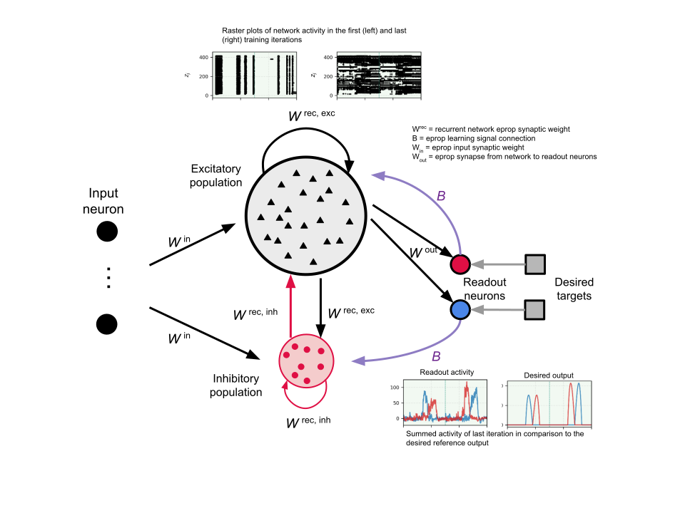

# Motor Controller Spiking Neural Network (SNN) Model with e-prop

This repository contains code, data, and neuron models for simulating and analyzing motor control experiments using spiking neural networks and the e-prop (eligibility propagation) learning algorithm. The network models motor cortex (M1) activity for a movement task, using e-prop learning as implemented in NEST.

<p align="center">
   
</p>

**Figure 1. Schematic of the spiking neural network (SNN) architecture for motor control.**  
The left input symbols represent the external planner population and its RBF encoding. The figure abstracts the RBF layer: the `W_in` projection is the RBF-to-recurrent projection, not a direct planner-to-recurrent connection. The RBF neurons are connected to the complete recurrent population, which models the motor cortex (M1). Within the reservoir, black triangles represent excitatory spiking neurons, while the red circle at the bottom denotes the inhibitory population used for recurrent inhibition.
The recurrent excitatory population projects to two readout populations via e-prop synapses: a red circle ("pos" channel) and a blue circle ("neg" channel). Gray arrows from the readouts point to target signals. The purple feedback arrows labeled "B" represent the e-prop learning-signal connection from both readout populations to all recurrent neurons, including inhibitory neurons. The recurrent input and recurrent excitatory projections are plastic e-prop connections; the inhibitory recurrent projection is plastic when `synapses.inh.plastic` is enabled.
Colors and shapes encode the input/RBF interface, excitatory reservoir neurons, inhibitory population, and output channels.


## Repository Structure

- [`src/motor_controller_model/`](src/motor_controller_model/) - Main package containing all code for running motor control experiments, training spiking networks, analyzing results, and visualizing outputs. See its [README](src/motor_controller_model/README.md) for detailed usage and options.
- [`src/motor_controller_model/nestml_neurons/`](src/motor_controller_model/nestml_neurons/) - NESTML neuron model files and scripts for compiling custom neuron modules. See its [README](src/motor_controller_model/nestml_neurons/README.md) for details.
- `results/` - Output directory for simulation results, plots, and data (created automatically). Curated reference runs are kept under `results/legacy_sequence/` and `results/sample_good_results/`.
- [`pyproject.toml`](pyproject.toml) - Python package configuration and pip dependencies.
- [`environment.yml`](environment.yml) - Conda/mamba environment specification including `nest-simulator` and build tools (CMake, Boost, GSL).

## Getting Started

### 1. Install the package

**Inside the Docker container (NEST is pre-installed)**

```bash
pip install -e ".[standalone]"
```

**Standalone / local development**

`nest-simulator` is a compiled dependency that cannot be installed via pip. Start with conda/mamba, then install the package:

```bash
mamba env create -f environment.yml
mamba activate motor-controller
pip install -e ".[standalone]"
```

### 2. Compile NESTML Neurons

```bash
python -m motor_controller_model.nestml_neurons.compile_nestml_neurons
```

### 3. Quick Start

Train the M1 network and run a standalone inference test:
```bash
python -m motor_controller_model.run_m1 --force-retrain \
    --nest-module "./src/motor_controller_model/nestml_neurons/nestml_install/motor_neuron_module.so"
```

When running inside the controller devcontainer, use the `custom_stdp_module` NEST module:
```bash
python -m motor_controller_model.run_m1 --output-dir /sim/controller/artifacts/m1/ --force-retrain --nest-module=custom_stdp_module
```

This trains the network (or loads cached weights if config matches), then runs an inference test and saves results and plots to the output directory.

**For detailed usage, command-line options, and parameter sweeps**, see the [motor_controller_model README](src/motor_controller_model/README.md).

Training trajectories and target rates are generated from the YAML configuration with
`minjerk-dynamics`; no external dataset is required. The main notebook is
[`motor_controller_eprop_tutorial.ipynb`](motor_controller_eprop_tutorial.ipynb).

### 4. Additional Resources

- **Network Architecture:** See [`overview_network.svg`](overview_network.svg) for a visual summary of the spiking neural network architecture (Figure 1 above)
- **Package Documentation:** See [`src/motor_controller_model/README.md`](src/motor_controller_model/README.md) for detailed API usage
- **Outdated files:** Legacy scripts, tutorials, and the monolithic training script are in [`outdated/`](outdated/).


## License
No license file or license declaration is currently included in this repository.
